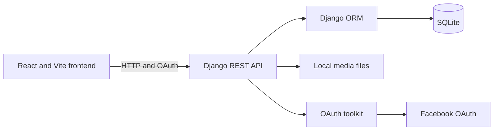

# TwasolBook
A Django REST and React blog for readers and authors who need to browse, search, and manage posts.

**Stack:** React, Vite, Django REST Framework, SQLite.

## Screenshots


Capture these files using the plan in [docs/screenshot-plan.md](docs/screenshot-plan.md). The image files are planned and are not included yet.

## Features

- Browse published posts ordered by publication date ([blog/models.py](DjangoBlog/blog/models.py), [App.jsx](ReactBlog/src/App.jsx)).
- Search posts by title, slug, excerpt, or content ([api/views.py](DjangoBlog/api/views.py), [PostSearch.jsx](ReactBlog/src/components/post/PostSearch.jsx)).
- Open a post by its numeric ID from the post cards ([main.jsx](ReactBlog/src/main.jsx), [SinglePost.jsx](ReactBlog/src/components/post/SinglePost.jsx)).
- Register an account and request an OAuth access token ([users/views.py](DjangoBlog/users/views.py), [Login.jsx](ReactBlog/src/components/AUthentication/Login.jsx)).
- Create, edit, and delete posts through the admin pages and authenticated API views ([api/views.py](DjangoBlog/api/views.py), [create.jsx](ReactBlog/src/components/admin/create.jsx)).
- Upload a post image with the create form; the backend accepts multipart form data ([create.jsx](ReactBlog/src/components/admin/create.jsx), [api/views.py](DjangoBlog/api/views.py)).

## Tech Stack

- **Frontend:** React 19 and Vite build the single-page interface. React Router maps browser paths; Material UI supplies components; Axios sends API requests.
- **Backend:** Python, Django 4.2, and Django REST Framework serve the API. CORS headers allow the local Vite origin; OAuth packages provide token and social-auth routes.
- **Database:** SQLite through the Django ORM; Pillow supports image fields.
- **DevOps:** Docker Compose, Python 3.11 image, and Node 22 image.
- **AI:** None.

## Architecture

The Vite React client calls the Django REST API. Django uses its ORM with a local SQLite database and stores uploaded images in local media storage. OAuth routes are provided by `drf-social-oauth2`; Facebook sign-in is configured through the social-auth packages. The code has no queue or LLM integration.

The browser route table lives in `ReactBlog/src/main.jsx`. Home and search call the post list endpoint; detail requests one post; management pages call create, update, and delete endpoints.

At runtime, the browser sends HTTP requests to Django on port 8000.
Django serializes model records as JSON and reads or writes data through its ORM.
Uploaded image files are stored in the local media directory.
OAuth routes handle token requests; Facebook exchange requires provider configuration.
No background worker or message queue is configured.



## Run Locally

**Prerequisites:** Docker Compose v2. The manual commands below require Python 3.11, Node.js 22, and npm.

1. Create the root environment file:

   ```powershell
   Copy-Item .env.example .env
   ```

2. Start both services:

   ```sh
   docker compose up --build
   ```

3. Open the frontend at <http://localhost:5173>, Django admin at <http://localhost:8000/admin/>, and API docs at <http://localhost:8000/api/docs/>.

4. Create an admin account:

   ```sh
   docker compose exec backend python manage.py createsuperuser
   ```

5. Sign in to Django admin, add a category, then add a published post with a title, excerpt, body, and optional image. This supplies data for the feed, detail, and search screens.

Useful Compose commands:

```sh
docker compose logs -f backend frontend
docker compose down
```

The Compose backend runs migrations before starting Django. SQLite and uploaded media live under the mounted `DjangoBlog/` directory.

For a manual development setup, copy `.env.example` to `DjangoBlog/.env` and `ReactBlog/.env`.
Run the backend commands from `DjangoBlog/`:

```sh
python -m venv .venv
.venv/Scripts/activate
pip install -r requirements.txt
python manage.py migrate
python manage.py runserver
```

Run the frontend commands from `ReactBlog/` in another terminal:

```sh
npm ci
npm run dev
```

The frontend uses a fixed local API base URL in `src/axios.jsx`; keep Django available at port 8000.

To run the configured ESLint check from `ReactBlog/`:

```sh
npm run lint
```
The registered browser routes are `/`, `/register`, `/login`, `/logout`, `/post/:slug`, `/search`, `/admin`, `/admin/create`, `/admin/edit/:id`, and `/admin/delete/:id`.
The parameter called `slug` is used as a numeric post ID by the cards and API request.

Environment variables read by the code:

| Variable | Used by | Purpose |
|---|---|---|
| `DJANGO_SECRET_KEY` | Django | Secret key; defaults to a development-only value |
| `DEBUG` | Django | Enables debug mode when set to `True` |
| `ALLOWED_HOSTS` | Django | Comma-separated allowed host names |
| `CORS_ALLOWED_ORIGINS` | Django | Comma-separated browser origins |
| `SOCIAL_AUTH_FACEBOOK_KEY` | Django | Facebook app key |
| `SOCIAL_AUTH_FACEBOOK_SECRET` | Django | Facebook app secret |
| `SOCIAL_AUTH_LOGIN_REDIRECT_URL` | Django | Redirect after social login |
| `VITE_FACEBOOK_APP_ID` | Vite | Facebook login app ID |
| `VITE_CLIENT_ID` | Vite | OAuth client ID used by login forms |
| `VITE_CLIENT_SECRET` | Vite | OAuth client secret currently read by frontend code |
| `VITE_GRANT_TYPE` | Vite | OAuth grant type; defaults to `password` |
| `VITE_API_BASE_URL` | Facebook helper | Intended API origin; current code reads `import.meta.VITE_API_BASE_URL`, not `import.meta.env` |

The main Axios client hard-codes `http://127.0.0.1:8000/api/` in [axios.jsx](ReactBlog/src/axios.jsx).
The `.env.example` uses placeholders only. Vite client variables are bundled into browser code.

## API Overview

The API is mounted at `http://localhost:8000`. Read and search requests are public; write views require authentication and object-level checks as implemented in [api/views.py](DjangoBlog/api/views.py).

The post list and category views use read-only-or-authenticated permissions.
Post create requires an authenticated request.
The post object permission allows safe reads and checks ownership for changes.
User registration explicitly allows anonymous requests.
Use `/api/docs/` to inspect the browsable API documentation.

| Method | Path | Purpose |
|---|---|---|
| GET | `/api/category/` | List categories |
| GET | `/api/post/` | List published posts; supports `?search=` |
| GET | `/api/post/{id}` | Retrieve a post by numeric ID |
| POST | `/api/post/admin/create/` | Create a post with multipart form data |
| GET, PUT, PATCH | `/api/post/admin/edit/postdetail/{id}/` | Retrieve or update a post |
| PUT, PATCH | `/api/post/admin/edit/{id}/` | Update a post |
| GET, DELETE | `/api/post/admin/delete/{id}/` | Retrieve or delete a post |
| POST | `/api/user/register/` | Register a user |
| GET | `/api/user/current/` | Return current-user fields |
| GET | `/api/docs/` | Browse DRF API documentation |
| GET | `/api/schema` | Retrieve the API schema |
| OAuth methods | `/auth/…` | OAuth routes included from `drf-social-oauth2` |

Example request:

```http
GET /api/category/ HTTP/1.1
Host: localhost:8000
Accept: application/json
```

Example response:

```json
[{"id":1,"name":"Django"}]
```

Search with `GET /api/post/?search=Django`; the backend checks title, slug, excerpt, and content.
The single-post endpoint expects a numeric primary key. It does not resolve the model slug.

## Design Decisions

- SQLite is configured directly in Django settings, keeping local setup to one database file ([settings.py](DjangoBlog/DjangoBlog/settings.py)).
- The public post list uses a custom manager that filters to published posts and orders newest first ([blog/models.py](DjangoBlog/blog/models.py)).
- Separate `objects` and `postobjects` managers let admin code access all posts while public reads use published posts.
- Post creation accepts multipart and form data so one request can include an image ([api/views.py](DjangoBlog/api/views.py)).
- Django media settings store uploaded images locally; no object storage service is configured.

## Status & Next Steps

- The core list, search, detail, registration, and post management screens exist, but authentication and writes need end-to-end verification.
- The post detail API accepts a numeric primary key while the React route parameter is named `slug`; cards currently link by ID. Slug lookup is not implemented.
- The current-user view does not set an authenticated permission class. The create and edit forms send an author ID from frontend code.
- Frontend logout calls a blacklist route that is not included in project URL configuration.
- The menu links to Blog, About, and Contact, but no separate React routes exist for those paths.
- Facebook login depends on provider credentials. The frontend reads an OAuth client secret, exposing that value in client-side code; move the exchange to a backend flow before production use.
- The checked-in tests include references to Django's built-in `User` while the project configures a custom user model. Repair the suite before relying on its coverage.
- The backend has no configured PostgreSQL service, queue, cloud file store, or deployment setup.
- The Vite production build passed in this environment. Docker could not be run because the Docker CLI is unavailable.
- Django tests could not start because `python-dotenv` is missing from the available interpreter; the requirements install was attempted in a temporary environment.


